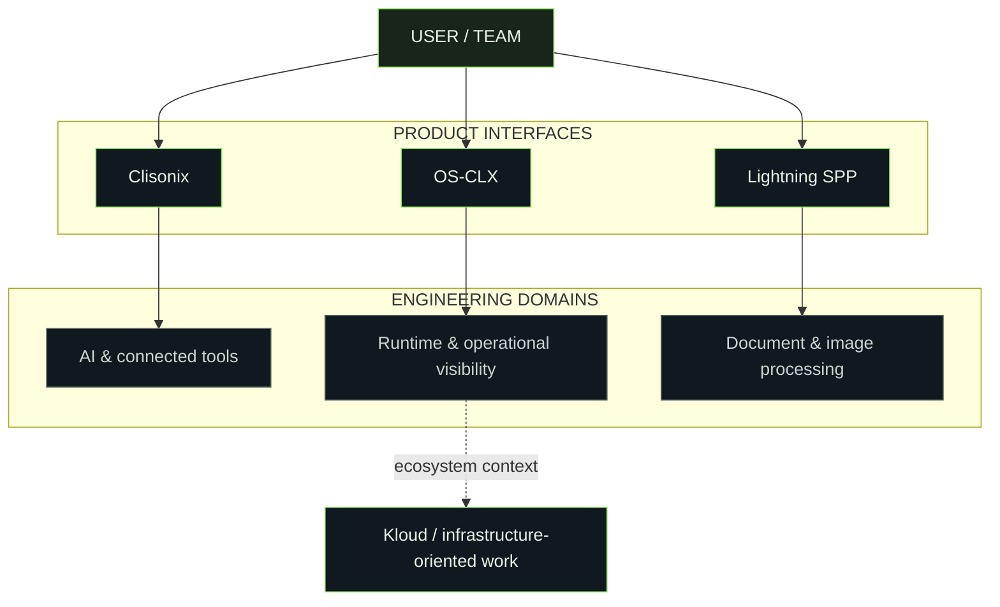

<div align="center">

<a href="https://github.com/Web8kameleon-hub">
  
</a>

# LEDIAN AMATI

### Independent Software Developer · Product Builder · Founder

<a href="https://git.io/typing-svg">
  
</a>

<p>
  Based in Bochum, Germany · Owner of ABA GmbH
</p>

<p>
  I build software across product interfaces, backend services,<br/>
  AI integrations, document processing, and runtime operations.
</p>

<p>
  <a href="https://github.com/Web8kameleon-hub">
    
  </a>
  <a href="https://aiagi.io/">
    
  </a>
  <a href="https://scanprocessprint.com/">
    
  </a>
  <a href="https://kameleon.life/">
    
  </a>
</p>

[Explore the ecosystem](#the-ecosystem) ·
[Engineering approach](#engineering-approach) ·
[Work with me](#work-with-me)

</div>

---

## > whoami

```text
┌─ ledian@web8-kameleon ──────────────────────────────────────┐
│                                                           │
│  ROLE       Independent developer & product builder        │
│  BASE       Bochum, Germany                               │
│  COMPANY    ABA GmbH                                      │
│  FOCUS      Connected applications and operational tools   │
│                                                           │
│  INTERFACE → API → SERVICE → RUNTIME → DEPLOYMENT           │
│                                                           │
└───────────────────────────────────────────────────────────┘
```

I am Ledian Amati, the independent builder behind the projects
featured here.

My work connects user-facing applications with the services,
integrations, and operational tooling behind them.

I work across the product lifecycle: shaping an idea, implementing
the interface and backend, connecting services, investigating failures,
and improving the deployment path.

This profile is a map of that work — not a claim that every component
has reached the same level of maturity.

## > WEB8 / ecosystem

WEB8 is the context for my work across applications, runtime operations,
infrastructure, and document processing. This profile groups those projects
by their purpose; the map below is conceptual and does not assert that every
component is connected or deployed together.

### Live sites

- [OS-CLX](https://aiagi.io/) — runtime and operational interfaces
- [Lightning SPP](https://scanprocessprint.com/) — document processing
- [Kameleon Life](https://kameleon.life/) — ecosystem website
- [Clisonix](https://www.clisonix.com/) — AI workspace

These links point to public websites; availability and functionality can vary.

## > the ecosystem

<table>
<tr>
<td width="50%" valign="top">

### 01 / CLISONIX

**AI workspace & connected applications**

A workspace bringing together conversational AI, research,
documents, and connected tools.

My work includes product interfaces, service integration,
diagnostics, and deployment-related improvements.


</td>
<td width="50%" valign="top">

### 02 / OS-CLX

**Runtime operations & control plane**

A project connecting runtime information, node state,
scheduling, signals, and operational interfaces.

My work includes the control-plane experience, API integration,
telemetry-related verification, and deployment tooling.

[Visit website →](https://aiagi.io/)


</td>
</tr>
<tr>
<td width="50%" valign="top">

### 03 / LIGHTNING SPP

**Document & image processing**

A self-hostable .NET project focused on scan, process,
and print workflows.

My work includes processing functionality, integration,
build and CI maintenance, and deployment documentation.

[Visit website →](https://scanprocessprint.com/)

[Explore repository →](https://github.com/Web8kameleon-hub/Lightning-SPP-3.14)

</td>
<td width="50%" valign="top">

### 04 / KLOUD

**Connected infrastructure & services**

An infrastructure-oriented project within the wider
Kameleon Life ecosystem.

My work includes service integration, development tooling,
CI fixes, and security-related maintenance.

[Visit website →](https://kameleon.life/)


</td>
</tr>
</table>

### Further exploration

- [neuclx](https://github.com/Web8kameleon-hub/neuclx)


- [All repositories](https://github.com/Web8kameleon-hub?tab=repositories)

## > system map



> Conceptual portfolio map. It groups areas of work; it is not a
> live topology, deployment diagram, or guarantee of connectivity.

## Engineering portfolio

```text
WEB8 / CLISONIX ECOSYSTEM
|
|-- APPLICATIONS     Clisonix / OpenMind / Ocean / NeuCLX
|-- RUNTIME          OS-CLX / NodeDB Fluid / Nanodecibel / digital chips
|-- INFRASTRUCTURE   Kloud / GRAM / GS26 / mesh research
|-- PROCESSING       Lightning SPP / wwwmmm / MegaLayer
`-- DISTRIBUTION     Rust crates / Python packages / SDK work
```

This portfolio map groups engineering areas; it is not a live deployment diagram.

| Work | Scope | Explore |
| :--- | :--- | :--- |
| **WEB8** | Ecosystem and application work | [Public repository](https://github.com/Web8kameleon-hub/web8) |
| **Clisonix / Ocean** | AI-facing applications and integration tooling | [Clisonix](https://www.clisonix.com/) · [Ocean Core on PyPI](https://pypi.org/project/clisonix-ocean-core/) |
| **OS-CLX** | Runtime, operational interfaces and research components | [OS-CLX site](https://aiagi.io/) |
| **NodeDB Fluid** | Deterministic scheduling reference model | [Rust crate](https://crates.io/crates/clx-nodedb-fluid) |
| **Nanodecibel** | Fixed-point quality model | [Rust crate](https://crates.io/crates/clx-nanodecibel) |
| **Lightning SPP / wwwmmm** | .NET document and image processing | [Source](https://github.com/Web8kameleon-hub/Lightning-SPP-3.14) · [Website](https://scanprocessprint.com/) |
| **GRAM** | Graph nodes, search and ecosystem discovery work | Wider engineering portfolio |
| **GS26** | ALBA data, graph and curriculum-related engine work | Wider engineering portfolio |
| **MegaLayer** | Text analysis and numeric transformation work within Ocean | Wider engineering portfolio |
| **NeuCLX** | Project within the wider portfolio | [Public repository](https://github.com/Web8kameleon-hub/neuclx) |
| **Ultrawebthinking** | Browser and application work | [Public repository](https://github.com/Web8kameleon-hub/Ultrawebthinkig-v2) |
| **Kloud / Clisonix Cloud** | Infrastructure and distributed mesh-oriented work | [Kloud](https://github.com/Kameleonlife/Kloud) · [Clisonix Cloud](https://github.com/Kameleonlife/Clisonix-cloud) |
| **RehaConnect** | Application project | [Public repository](https://github.com/Web8kameleon-hub/rehaconnect) |

NodeDB Fluid is described by its package as research software. GRAM and
MegaLayer are represented here by work inspected in local project materials;
their inclusion does not establish a verified distributed integration.

### Digital chips and hardware research

OS-CLX includes runtime chip concepts and software components spanning
Stigma, Nanodecibel, Nanogrid, NodeDB Fluid and memory. The wider work also
explores mesh-connected systems and mappings from software primitives to
specialized hardware. These are different stages of work: runtime software
and hardware research specifications should not be read as evidence that a
fabricated chip or a hardware mesh has been independently verified.

## Published packages

| Registry | Package | What to inspect |
| :--- | :--- | :--- |
| **crates.io** | [clx-nodedb-fluid](https://crates.io/crates/clx-nodedb-fluid) | Scheduling reference model |
| **crates.io** | [clx-nanodecibel](https://crates.io/crates/clx-nanodecibel) | Fixed-point quality model |
| **PyPI** | [clisonix-ocean-core](https://pypi.org/project/clisonix-ocean-core/) | Ocean integration package |
| **PyPI** | [clisonix-lab](https://pypi.org/project/clisonix-lab/) | Research-lab integration and health utilities |

Package pages provide versions and installation instructions. Publication alone
does not establish the status of every system a package references.

## Algorithm and model work

The ecosystem includes named computational models and algorithms, from
operational scoring to scheduling and text analysis:

| Model or algorithm area | What it does | Inspect |
| :--- | :--- | :--- |
| **Nanodecibel** | Calculates a deterministic fixed-point quality score from load, queue depth, latency and saturation. | [Published crate](https://crates.io/crates/clx-nanodecibel) |
| **NodeDB Fluid** | Converts bounded quality, pressure and resonance signals into scheduling decisions. | [Published crate](https://crates.io/crates/clx-nodedb-fluid) |
| **Stigma Core** | Maps operational signals into bounded control states for telemetry and scheduling. | OS-CLX software reference |
| **TIDE Core** | Evaluates node rhythm and fabric signals to derive a coherence state. | OS-CLX software reference |
| **MegaLayer** | Applies text-feature analysis and numeric transformations in an Ocean processing path. | Clisonix engineering work |
| **GRAM / GS26** | Graph, search and data-processing work across the Clisonix ecosystem. | Clisonix engineering work |

The OS-CLX reference models include experimental research software. The names
identify work in the ecosystem; independent novelty, comparative performance
and hardware acceleration are separate questions requiring evidence.

## > engineering approach

### Build the connection, not only the screen

I am interested in what happens after a user presses a button:
the request, the service boundary, the result, and the failure path.

### Make the product easier to understand

A broad system still needs a clear entry point.

One direction I am developing in OpenMind is a conversation-first
interface: a focused chat surface, with tools and plugins accessible
through a `+` menu instead of permanent competing panels.

### Keep implementation and claims aligned

A registered route is not the same as a verified workflow.
A running service is not the same as a successful user request.

I aim to keep those distinctions visible in the product,
documentation, and release process.

### Treat debugging as engineering work

Deployment fixes, diagnostics, dependency maintenance,
and integration repairs are part of building a usable system —
not separate from it.

## > selected engineering threads

The repository history includes work on:

| Area | Examples of work |
| :--- | :--- |
| Product integration | Connecting interfaces to runtime and service routes |
| Operations | Health checks, diagnostics, telemetry, and runtime views |
| Deployment | Remote deployment tooling, container configuration, and startup checks |
| Security maintenance | Dependency fixes and webhook signature verification |
| CI / release process | Runner validation, workflow repairs, and evidence-related checks |
| AI interfaces | Conversational tools, service integration, and simpler interaction patterns |
| Documents | Processing workflows and bridge-related fixes |

These are areas of implementation and maintenance.
A contribution title alone does not establish production readiness;
the repository context and demonstrations matter.

## > inspect the work

<table>
<tr>
<td valign="top" width="33%">

### SOURCE

Explore implementation,
documentation, and project structure.

[Browse repositories →](https://github.com/Web8kameleon-hub?tab=repositories)

</td>
<td valign="top" width="33%">

### CHANGES

Review the evolution of the work:
features, repairs, refactoring,
and integration decisions.

[Browse pull requests →](https://github.com/pulls?q=is%3Apr+author%3AWeb8kameleon-hub)

</td>
<td valign="top" width="33%">

### PRODUCTS

Start with a public interface,
then connect what you see
to the implementation.

[Browse profile →](https://github.com/Web8kameleon-hub)

</td>
</tr>
</table>

<details>
<summary><b>Open the technical review checklist</b></summary>

<br/>

When discussing a project, I prefer concrete questions:

- What problem is this component intended to solve?
- Which parts did I implement or integrate?
- What happens between the interface and the backend?
- Which dependencies must be available?
- How does the system report a failed operation?
- What has actually been tested?
- What remains incomplete or unverified?
- What would I change next, and why?

A useful technical conversation includes limitations,
not only the happy path.

</details>

## > work with me

I am interested in software development opportunities where I can
contribute across implementation, integration, and product delivery.

### Relevant areas

- Full-stack application development
- Backend APIs and service integration
- .NET document-processing applications
- AI-enabled product interfaces
- Runtime and operational tooling

I can walk through selected projects, explain my contribution,
and discuss implementation choices and remaining limitations.

**Location:** Bochum, Germany<br/>
**Company:** ABA GmbH<br/>
**Contact:** [GitHub profile](https://github.com/Web8kameleon-hub) ·
[GitHub repositories](https://github.com/Web8kameleon-hub?tab=repositories)

---

<div align="center">

```text
01010111 01000101 01000010 00111000

LESS NOISE.
CLEARER INTERFACES.
CONNECTED SYSTEMS.
```

<sub>
Independent work. Continuous learning. Visible iteration.
</sub>

</div>
